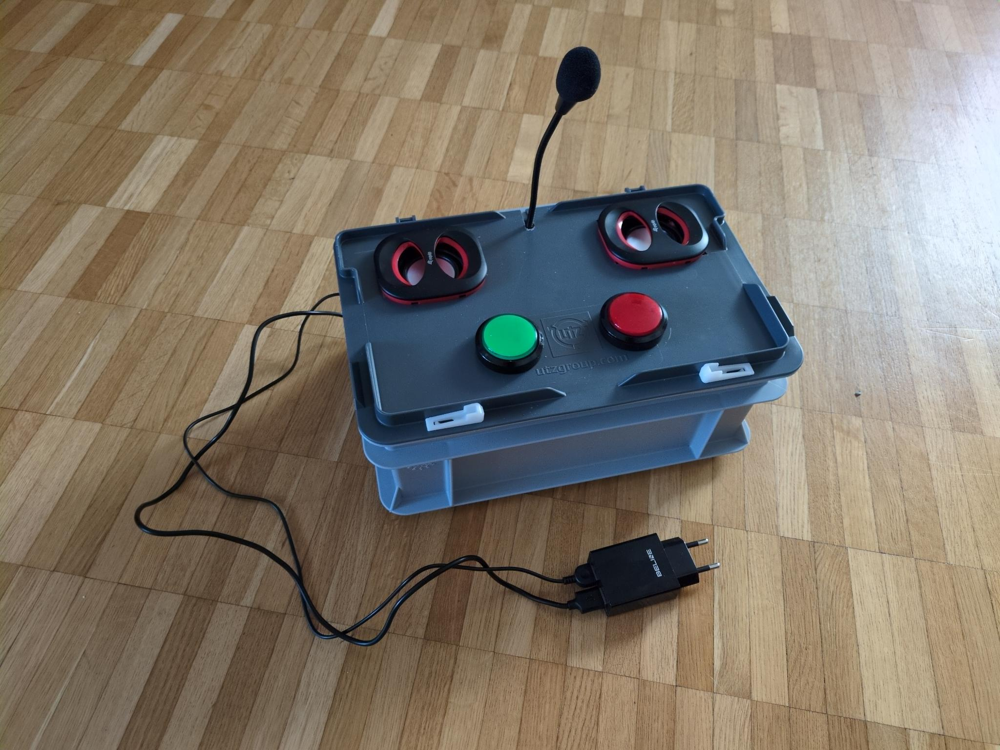

# Button Box — two-button fork

A fork of [Button Box](https://github.com/button-box/button-box) for a
two-button voice-message box: a **green** and a **red** button, each bound to
one WhatsApp group. A tap plays that group's waiting voice messages (or replays
the last one); a hold records a reply to it. To change who a button reaches,
change the group's members on a phone.

The original project README, with the full upstream build and install guide,
is [README-upstream.md](README-upstream.md).

## What this fork changes

All of this applies when `MSGBOX_CHANNEL_PINS` is set; single-button boxes keep
the upstream behaviour.

- **Button channels:** two buttons, each with its own LED and its own WhatsApp
  group. An unbound button never falls back to another chat.
- **Setup without NFC:** the setup page binds a chat to each button instead of
  choosing a default recipient, running a voice test or pairing cards.
- **No dashboard after setup:** changes go through a full reset (hold green while
  plugging in) or, for a developer on the LAN, SSH.
- **Replay and send:** a recording is replayed and sent when heard to the end;
  a press during the replay deletes it.
- **Replay on tap:** with nothing waiting, a tap replays the button's last
  message.
- **Messages per reply** (optional): limits sends per button until a reply has
  been played.
- **WhatsApp logout recovery:** if WhatsApp logs the box out, it switches to
  setup on the same Wi-Fi with both LEDs blinking, and relinking the same
  account keeps the button bindings.

## Documentation

| Document | Contents |
| --- | --- |
| [docs/channel-box.md](docs/channel-box.md) | Configuration, daily use, reset, logout recovery, the required label, shipping checklist |
| [hardware/README-channel-box.md](hardware/README-channel-box.md) | Parts, photos, adapter schematic (optional), pins, power |
| [TASKS.md](TASKS.md) | Decisions, task status and known gaps |
| [MODIFICATION.md](MODIFICATION.md) | The original goals for this fork |
| [README-upstream.md](README-upstream.md) | Upstream build, install and project information |

## Install

Install as described upstream ([README-upstream.md](README-upstream.md) and
[docs/installation.md](docs/installation.md)), then set the channel lines in
`/etc/messagebox/env` from [docs/channel-box.md](docs/channel-box.md#configuration),
initialize Wi-Fi onboarding and finish setup through the hotspot. Physical
checks still matter: run the per-unit acceptance before a box leaves.

## Status

Developed and tested on one Raspberry Pi Zero 2 W. WhatsApp only (via `wacli`);
Signal is deferred. This fork is not submitted upstream.

The fork's changes were developed with AI assistance (Claude) and reviewed and
tested on hardware by the maintainer.

## License

Same as upstream: see [LICENSE](LICENSE).
