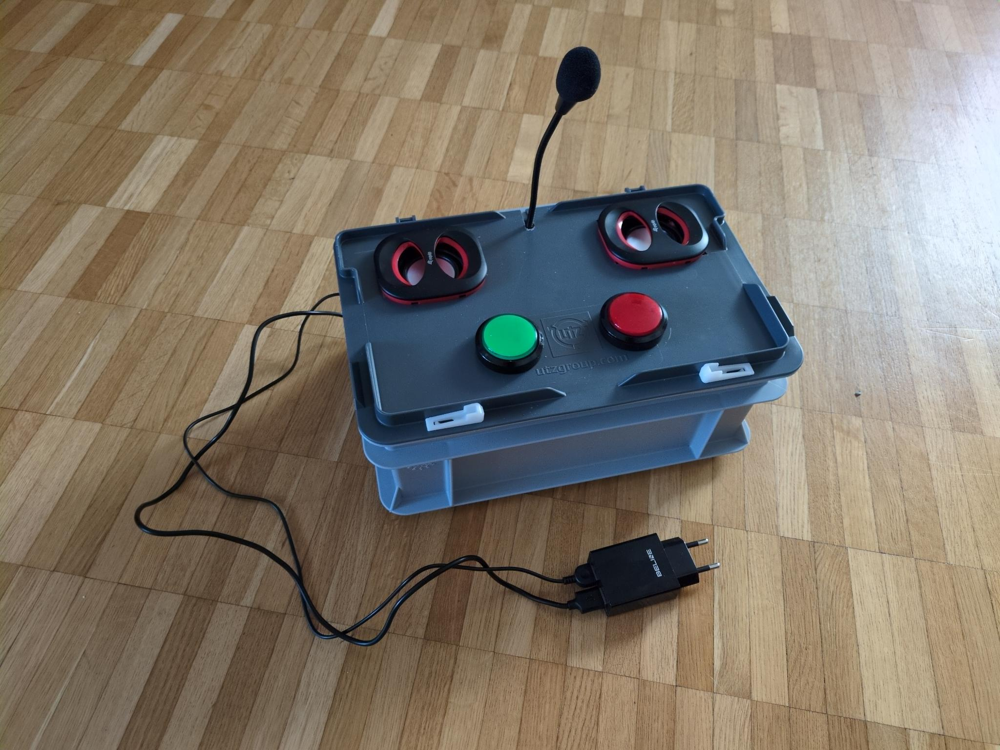
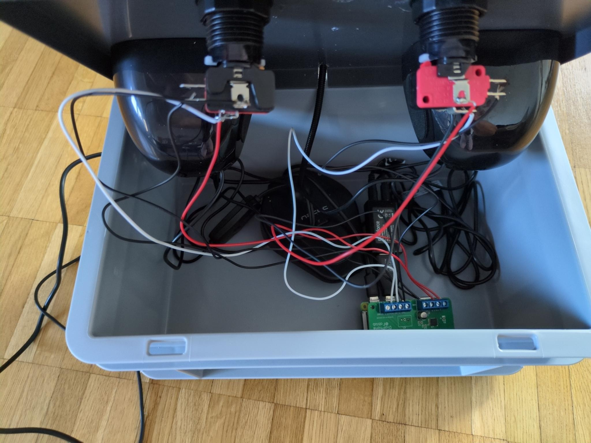

# Two-button channel box (fork hardware)

Hardware for the fork's two-button box: green and red arcade buttons, each bound
to one WhatsApp group. Software setup, daily use and the label every box needs
are in [docs/channel-box.md](../docs/channel-box.md).





## Parts

| Part | Notes |
| --- | --- |
| Raspberry Pi Zero 2 W | Runs the standard Button Box software. |
| USB audio dongle | One card for microphone and speaker (C-Media; mixer control `Speaker`). |
| Gooseneck microphone | On the dongle's input. Opened only while recording. |
| Two small speakers | Audio from the dongle; power them from 5 V directly (for example the charger's second USB port), not from the Pi. |
| Two arcade buttons with LEDs | Green (channel 1) and red (channel 2). The LEDs need 5 V. |
| Adapter board (optional) | Switches the 5 V LEDs from the Pi's 3.3 V GPIOs; see below. |
| Plastic storage box | Enclosure; holes for buttons, speakers and microphone in the lid. |
| 5 V USB charger, at least 2.5 A | Two ports: Pi and speakers. |

## Adapter board and schematic

[schematic-2-channel.svg](schematic-2-channel.svg) is the adapter used here: a
"DialPhone" shield (made for a rotary-phone project) with a DRV8876 driver,
PMODE lifted so its two outputs work independently. Its nSLEEP is GPIO18; hold it
high with `gpio=18=op,dh` in `/boot/firmware/config.txt`.

The adapter is **not required**. It was used only because the button LEDs need
5 V and a Pi GPIO gives 3.3 V, so each LED needs a switch. One logic-level
N-channel MOSFET per LED does the same job:

- LED + to 5 V, LED − to the MOSFET drain, source to GND.
- Gate to the LED's GPIO through about 100 Ω, with about 100 kΩ from gate to
  GND so the LED stays off while the Pi boots.
- Check whether your button's LED already has a series resistor for 5 V; add
  one if not.

Without the adapter, leave out the `gpio=18` line.

## Pins

| Channel | Button (to GND, internal pull-up) | LED switch |
| --- | --- | --- |
| 1 green | GPIO25 | GPIO24 (adapter: DRV8876 EN/IN1) |
| 2 red | GPIO8 | GPIO23 (adapter: DRV8876 PH/IN2) |

Matching `/etc/messagebox/env` lines (green is also the reset button):

```sh
MSGBOX_BUTTON_PIN=25
MSGBOX_LED_PIN=24
MSGBOX_CHANNEL_PINS=25:24,8:23
MSGBOX_SPEAKER_CONTROL=Speaker
```

With your own wiring, use any free GPIOs and list them as `BUTTON:LED` pairs in
`MSGBOX_CHANNEL_PINS`, channel 1 first.

## Power

Use a charger of at least 2.5 A. Power the speakers from 5 V directly; drawing
them from the Pi's USB data port causes brown-outs and noise.
